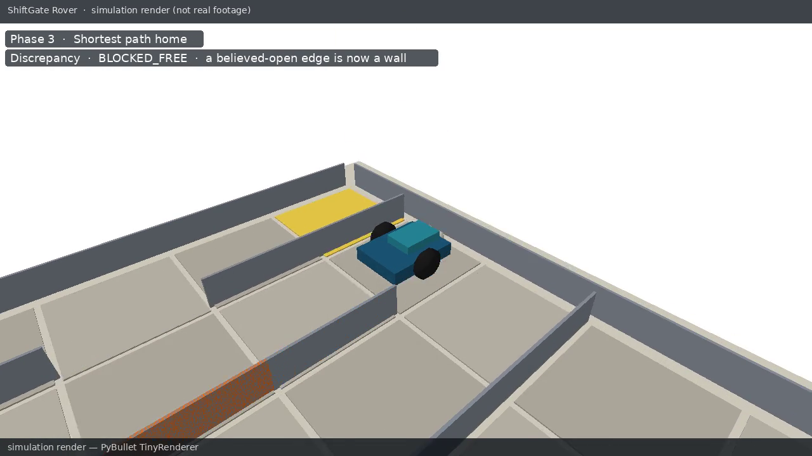

# ShiftGate Rover

A cost-friendly, 3D-printed **differential-drive** robot (ESP32 + micro-ROS) that explores an *unknown* 5×5 tabletop maze, builds a **witnessed occupancy** map, collects a package in the far corner, and then has to get home **after a gate has silently moved**.

The task is small.  The problem is not “solve a maze”.  It is:

> Detect that the world no longer matches the map, classify the mismatch, and replan under trust-weighted costs — the same reasoning a warehouse robot uses when a pallet appears in a previously free aisle.

**Target hardware cost (India, November 2026): ≈ ₹2,400–2,700**, comfortably under ₹3,500.  See [BOM.md](BOM.md).

> **About the video.**  [`media/shiftgate_sim.mp4`](media/shiftgate_sim.mp4) is a **PyBullet TinyRenderer simulation render**, not a camera recording of a physical robot.  An optional Blender turntable of the printed parts is also a render.  Neither is real-world footage.

[](media/shiftgate_sim.mp4)

[Download the 25 s simulation render (MP4)](media/shiftgate_sim.mp4) · [Arena overview still](media/shiftgate_arena_overview.png)

## The arena, in one picture

Five open corridors stacked north–south, connected by staggered doors, plus a shortcut *shaft* down the centre column.  While the **orange gate** (the door between cells `(2,2)` and `(2,3)`) is open, the shortest path from the package `P` at `(4,4)` back to start `S` at `(0,0)` is **8 cells** and *must* use the gate.  After the instructor slides the gate shut — without telling the robot — the shortest remaining path is **12 cells**.

```
  +---+---+---+---+---+
4 |                 P |
  +   +---+   +---+---+
3 |                   |
  +---+---+   +---+   +     ← the gate lives on the centre shaft
2 |                   |
  +   +---+   +---+---+
1 |                   |
  +---+---+   +---+   +
0 | S                 |
  +---+---+---+---+---+
    0   1   2   3   4
```

## Learning goals (what “done” looks like)

Full module outcomes, exercises, and the assessment rubric: **[LEARNING.md](LEARNING.md)**.  In one line per module:

| # | Module | You can demonstrate that you… |
|---|---|---|
| 1 | CAD & fabrication | Generated every STL from the script, printed the chassis and arena clips with the published settings, and passed the 24 mm shaft-height jig. |
| 2 | Electronics & firmware | Flashed the ESP32, published wheel ticks and a 3-beam scan, and drove 20 cm straight with less than 3 cm of lateral error. |
| 3 | ROS 2 & URDF | Launched the robot description in RViz and teleoperated the same URDF in Gazebo. |
| 4 | Witnessed occupancy | Filled a 5×5 occupancy grid from the 3-beam model so every reachable cell is visited and every leaving edge is known. |
| 5 | Planning | Implemented (or used) A*; all 10 canned grids in the test suite return an optimal path. |
| 6 | Discrepancy & replan | Detected a `BLOCKED_FREE` gate shift within one cell and returned home on the 12-cell detour. |
| 7 | Sim-to-real | Ran the *same* `shiftgate_core` mission in PyBullet, in Gazebo, and on the robot, changing only the launch file. |

## Quick start (laptop, no hardware)

```bash
# 3.10–3.12 recommended (PyBullet ships wheels up to 3.11)
python -m venv .venv && source .venv/bin/activate
pip install -r requirements.txt

# Unit tests for the planner, mapper, and full mission
pytest -q software/shiftgate_core

# Headless mission check (must print CHECK OK)
python software/pybullet/simulate.py --check

# Simulation render (this is a render, not real footage)
python software/pybullet/simulate.py --record media/shiftgate_sim.mp4
```

Regenerate CAD (CadQuery 2.x):

```bash
# pixi add cadquery   or: conda install -c conda-forge cadquery
python cad/cadquery/generate_parts.py
python cad/verify_stls.py     # all parts must be watertight
```

If your lab uses FreeCAD instead:

```bash
freecadcmd cad/freecad/generate_shiftgate_parts.py
```

The STL and STEP files shipped in `cad/stl` and `cad/step` were exported from the CadQuery script and verified watertight with trimesh on 13 November 2026.

## Repository layout

```
projects/shiftgate-rover/
  README.md                 ← you are here
  LEARNING.md               curriculum, exercises, rubric
  BOM.md                    India parts list with verified links
  BUILD_GUIDE.md            print → assemble → wire → flash → run
  PRINT_SETTINGS.md         per-part slicer settings
  cad/                      CadQuery + FreeCAD, STL, STEP
  hardware/                 wiring diagram and pinout
  firmware/                 PlatformIO ESP32 + micro-ROS notes
  software/
    shiftgate_core/         pure-Python map / plan / replan
    pybullet/               simulator + video renderer
    ros2_ws/                description, gazebo, bringup, nav
  media/                    simulation renders
```

## Hardware in one paragraph

An ESP32-WROOM DevKit, two N20 6 V motors **with encoders**, a DRV8833 driver, one HC-SR04 in front and two short-range IR modules on the sides, a 4×AA pack for the motors, and USB power (a power bank you already own) for the ESP32.  The chassis, wheels, sensor brackets, a caster cup for an 8 mm steel ball, and the maze clips are 3D-printed in PLA.  Arena walls are 5 mm foam board from a stationery shop, held by printed clips; only the distinctive **gate** is a printed wall.

## Software stack

- **shiftgate_core** — occupancy with decaying *trust*, frontier exploration, A* with trust-weighted costs, discrepancy classification (`BLOCKED_FREE` / `OPEN_WALL`), and a mission state machine.  No ROS, no PyBullet.
- **PyBullet** — the same mission, kinematic playback, TinyRenderer video.
- **ROS 2 Humble or Jazzy** — URDF/xacro, a Gazebo Classic world (Humble) and a Gazebo Harmonic SDF (Jazzy), and nodes that wrap `shiftgate_core`.
- **micro-ROS** on the ESP32 publishes `/odom` and a 3-beam scan and subscribes to `/cmd_vel`.  A USB-serial fallback is included so you can start without a micro-ROS agent.

## What was and was not run in this repository

| Thing | Status |
|---|---|
| `shiftgate_core` unit tests | Run when this project was added (19 passed).  A GitHub Actions workflow is provided at `ci/shiftgate-tests.yml` — copy it to `.github/workflows/` to enable it. |
| PyBullet mission + MP4 render | Run; video is a simulation render |
| STL watertight check (trimesh) | Run; all 13 parts watertight |
| CadQuery export of STL/STEP | Run |
| FreeCAD headless export | Script provided; FreeCAD was not available on the authoring machine (apt unsigned, conda package not installed).  Use CadQuery, or run the FreeCAD script in your lab. |
| Gazebo | World and launch files are provided.  Gazebo was not executed on the authoring machine. |
| Physical build / flashing | Not performed here — follow [BUILD_GUIDE.md](BUILD_GUIDE.md) |

## Licence

MIT, same as the rest of the Physical AI Development Kit.
