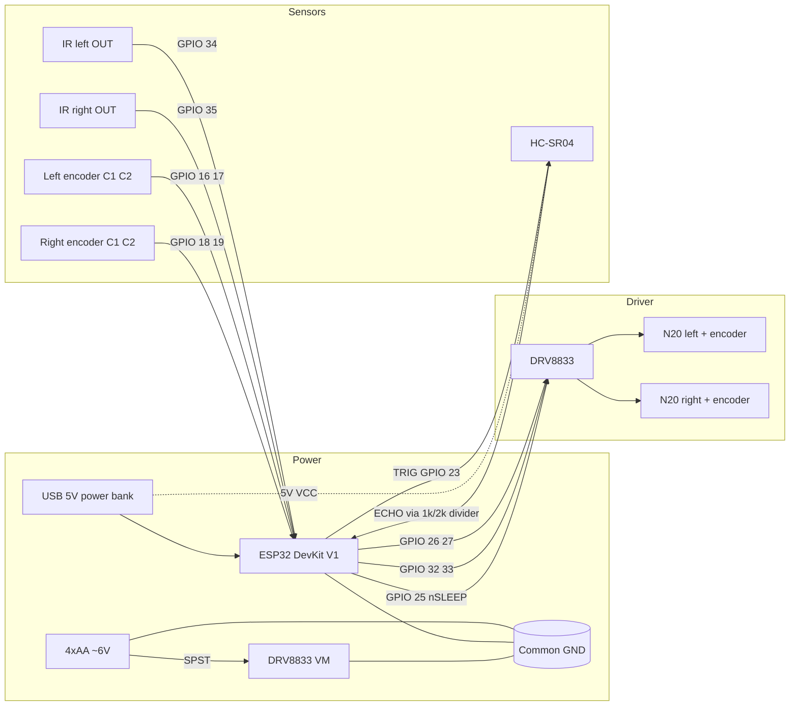

# Wiring and pinout

Two rules: **common ground**, and a **divider on the HC-SR04 echo pin**.  Everything else is just a pin table.

## Diagram



## Echo divider

The HC-SR04 is a 5 V part.  The ESP32 GPIO is **not**.  Trigger may be driven at 3.3 V.  Echo must be divided:

```
HC-SR04 ECHO ---- 1 kΩ ----+---- GPIO 4
                           |
                          2 kΩ
                           |
                          GND
```

V_GPIO ≈ 5 V × 2/3 ≈ 3.3 V.  Measure it once before you rely on it.

## Encoder colours (typical GA12-N20 loom)

These vary by seller.  **Buzz the loom** before you commit:

| Often | Function | ESP32 |
|---|---|---|
| Red / orange | Motor + | DRV8833 AOUT1 / BOUT1 |
| Black | Motor − | AOUT2 / BOUT2 |
| Blue | Encoder GND | GND |
| Green / bare | Encoder VCC | 3.3 V (not 6 V) |
| Yellow / white | Channel A / B | 16/17 or 18/19 |

If the robot drives backwards, swap that motor’s OUT1/OUT2 or invert the sign in firmware.  If the tick count decreases when the wheel rolls forward, swap the two encoder channels.

## Optional MPU-6050

| MPU-6050 | ESP32 |
|---|---|
| VCC | 5 V or 3.3 V (module has a regulator; prefer 5 V if that is what the board expects) |
| GND | GND |
| SDA | GPIO 21 |
| SCL | GPIO 22 |
| AD0 | GND (address 0x68) |

This pin-out does not collide with the sensors above.

## Power-on checklist

1. Switch off the motor pack.  Plug in USB.  The ESP32 should enumerate and not reset.
2. Close the motor switch with the robot on blocks.  The ESP32 must not reset when you command a slow spin.
3. Confirm GPIO 4 never sees more than 3.3 V with a wall in front of the ultrasonic.
